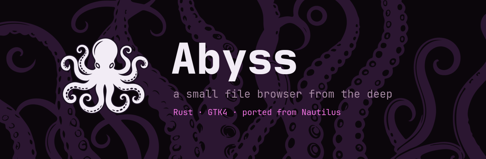
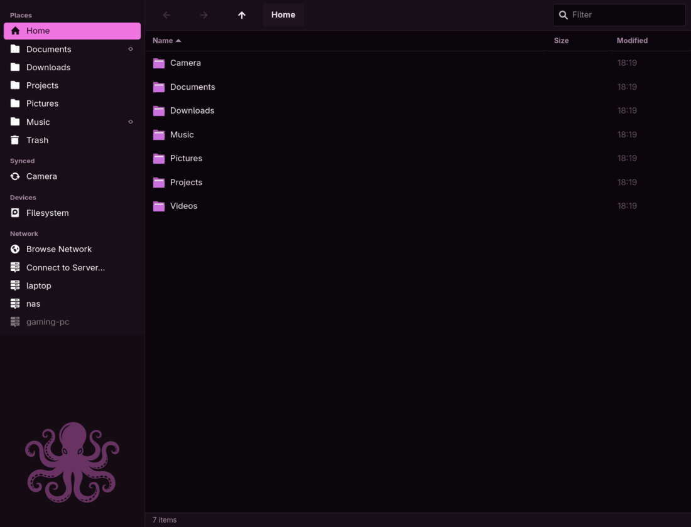
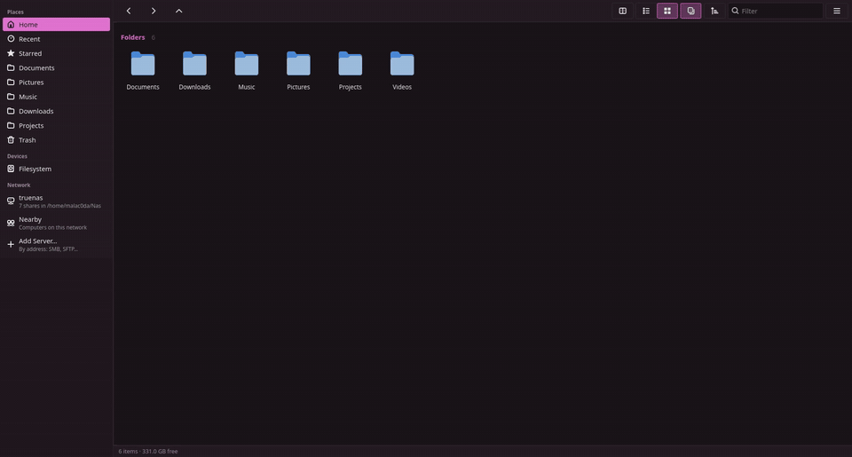
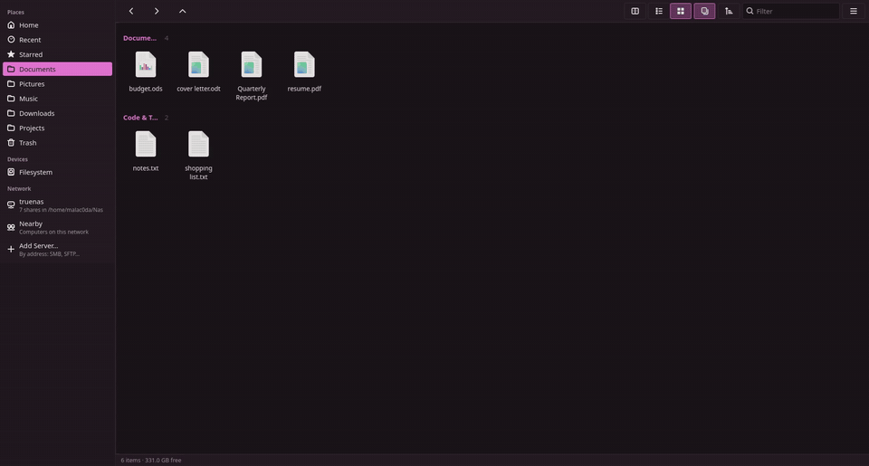
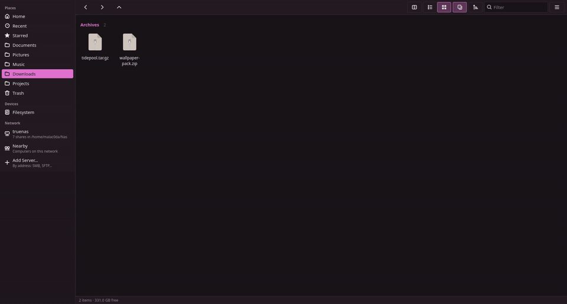
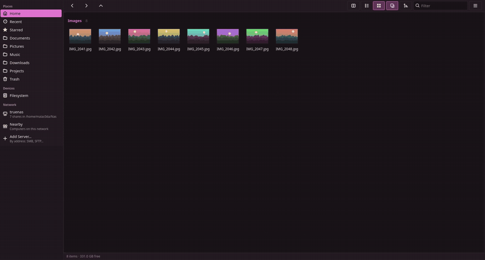
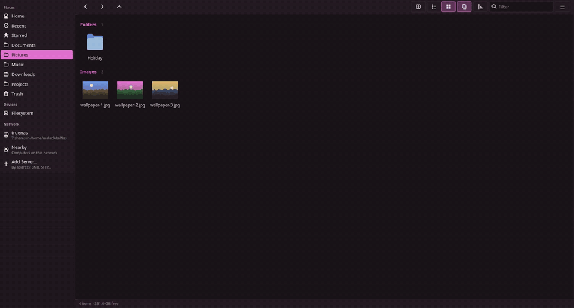
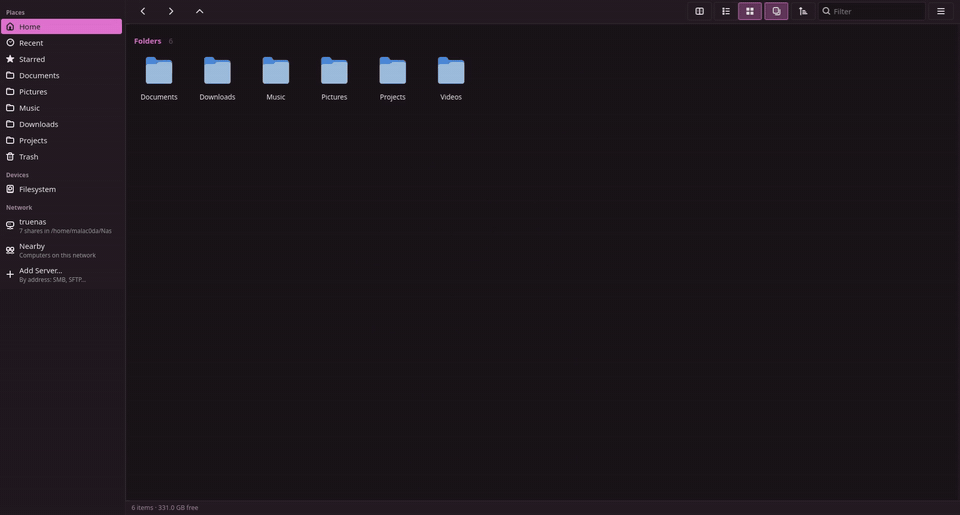
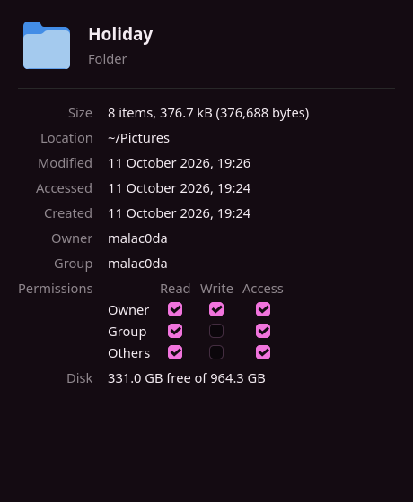
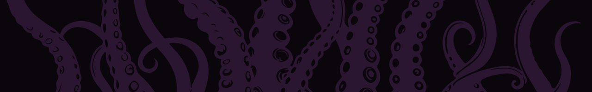

<p align="center">
  
</p>

<p align="center">
  
</p>

> [!WARNING]
> **Vibe coded.** Abyss was written almost entirely by an AI coding assistant
> (Claude), steered, reviewed and tested by a human on one machine. The logic
> is ported from Nautilus and the code is tested and linted strictly, but it
> hasn't had the years of real-world use a file manager deserves. Keep backups,
> and read the code before trusting it with anything you can't lose.

**Abyss** is a minimal GTK4 file browser written in Rust. It started as a fork
of GNOME Files (Nautilus) and ports its logic from the Nautilus sources (see
[below](#where-the-logic-came-from)), but none of the Nautilus C code is
shipped here. It's built for a tiling Wayland desktop (niri), follows the
wallpaper-driven theme of the rice it was made for, and puts network shares,
Tailscale peers and Syncthing folders right in the sidebar.

## Tour

**Browsing:** type to filter (the first match is selected, Enter opens it);
in a local folder, two or more letters also search its subfolders. Alt+Up to go up, Ctrl+L to type a location, Alt+Left to go back.

<p align="center">
  
</p>

**File operations:** F2 renames in a bar at the bottom (the extension stays
put), Ctrl+Shift+N makes a folder, and pasting onto an existing name asks what
to do instead of overwriting.

<p align="center">
  
</p>

**Archives:** Extract Here puts an archive with several items in its own
folder, and one with a single folder straight next to it.

<p align="center">
  
</p>

**Batch rename and undo:** with several files selected, F2 opens a bar with
simple rules (replace text, add text, number, change case) and a live
before → after preview; problems show in red before anything is renamed.
Ctrl+Z (or the footer's Undo) takes the whole rename back in one step.

<p align="center">
  
</p>

**Compress:** pick a name and a format (zip, tar.gz, tar.xz, tar.zst, 7z);
the archive is written aside and only appears when complete. Undo trashes it.

<p align="center">
  
</p>

**Sort and star:** a sort menu for every view (name, size, modified, type),
and Starred collects files from anywhere.

<p align="center">
  
</p>

**Network:** your mounted shares under their server, saved servers, Nearby,
and Add Server: pick a protocol, type an address (a pasted Windows
`\\host\share` works) and see the location it makes before connecting.

<p align="center">
  
</p>

**Properties** (Alt+Enter): size (folders counted in the background),
location, times, owner, permissions you can change, the default app for the
type, and free space on the disk.

<p align="center">
  
</p>

<sub>Recorded in a sandbox with demo files.</sub>

## Features

**Browsing**
- Local folders, the trash, and network locations through GVfs: SMB, SFTP,
  FTP, WebDAV, MTP, `network:///`. Unmounted locations mount on demand.
- Path bar with breadcrumbs (Ctrl+L to type a path, `~/…` or `smb://…`),
  back / forward / up, type-anywhere filtering, and a sort menu (name, size,
  modified, type; either direction, folders first or not) that every view
  follows. The footer shows the count, the selection's size and the free
  space where you are.
  Recently visited local folders stay loaded (and up to date), so going back
  is instant.
- Search through subfolders as you type: hits from the LocalSearch index show
  at once, and a walk over the folder on all cores finds the rest. Hits say
  which subfolder they're in.
- Thumbnails for images and videos; every other file shows its type's icon.
  Several render at once, and renders for rows scrolled past are stopped.
  Thumbnails go in the shared `~/.cache/thumbnails`, so Abyss also shows the
  ones other file managers already made. Local files only. Zoom from 20 to
  128 px with Ctrl+plus / Ctrl+minus or Ctrl+scroll.
- Copying, moving, deleting and trashing work on many files at once; local
  folders are measured and deleted using every core.
- List or grid view, each also **grouped by file type** (Folders, Images,
  Video, Audio, Documents, Code & Text, Archives, Other) with a heading per
  group. The switch sits next to the filter; in a narrow window the path
  keeps the top row and the controls move to a row of their own.
- **Tabs and a split view**, vifm style: one or two side-by-side panes,
  each with its own row of tabs. The toolbar, filter and footer follow the
  active pane (outlined); F5 / F6 copy or move the selection to the other
  pane, Tab switches panes and Ctrl+U swaps their folders. Tabs open next to
  the current one (Ctrl+T, middle-click, or "Open in New Tab"), closed tabs
  come back with Ctrl+Shift+T, and files dragged onto a tab go into its
  folder. Tabs and the split are remembered between launches; background
  tabs load only when first shown. The split button (or F3) turns the
  second pane off.
- SMB shares sit under their server: `truenas / batocera`, and Up from a
  share goes to the server's share list.

**Sidebar**
- Home, **Recent**, **Starred** (files starred from the right-click menu, or
  dropped on it, wherever they are), GTK bookmarks (shared with the file
  chooser), drives with eject.
- **Network**: shares the system mounts (fstab, autofs; one row per server
  when its shares sit in one folder, e.g. `truenas · 7 shares in ~/Nas`),
  connected and saved servers (right-click to forget), **Nearby** (what
  announces itself on the local network) and **Add Server…**: pick SMB,
  SFTP, WebDAV, FTP or NFS, type an address (a Windows `\\host\share`
  works too) and see the location it makes. It connects in the form, says
  why when it can't (and which protocols this system's GVfs lacks), and
  keeps servers that connect, in the same list as the GTK file chooser's.
- **Tailscale** peers (online first, SFTP or SMB) and **Syncthing** folders,
  shown only when those tools are installed. Synced folders that are already
  bookmarks get a sync badge instead of a second row.
- Drag rows to reorder them; Home, Trash, Filesystem and the network entries
  stay put. Drop folders on the sidebar to bookmark them.

**Files**
- Copy, cut, paste (interoperable with Nautilus' clipboard), duplicate,
  rename, new folder, trash, restore, delete, empty trash.
- **Undo** (Ctrl+Z, or the Undo the footer offers for a moment): trash,
  copy, move, rename, batch rename, new folder, extract and compress each
  note exactly what they did, and undoing reverses just that. Files a move
  merged into an existing folder go back without touching what was there.
  Deleting forever and replacing a file's content can't be undone.
- **Batch rename**: F2 with several files selected. Replace text, add text
  before / after, number them (start, digits, or keep the names), or change
  case, with a preview of every name; two files ending up with one name, or
  a name that's taken, stop it. Renames happen as one step, so names can be
  swapped or shifted along.
- **Compress…** to zip, tar.gz, tar.xz, tar.zst or 7z (bsdtar).
- **Properties** (Alt+Enter, also for the folder itself): sizes, times,
  owner, editable permissions, default app, free space.
- **Star / Unstar** from the right-click menu.
- Drag and drop with Nautilus' rules: move on the same filesystem, copy
  elsewhere, Ctrl/Shift for copy/move/link, hover a folder to open it.
- Name clashes ask: **Replace**, **Merge** folders, **Skip**, **Rename** or
  **Cancel**, with "apply to all". Every job can be cancelled.
- **Extract Here / Extract To…** for zip, 7z, rar, tar.*, iso and more
  (via bsdtar), locally and on network shares, password-protected archives
  included. Nothing is overwritten and cancelling leaves nothing behind.
- **Open With Other Application…** with recommended apps, search, and
  "always use for this file type".

**Errors and settings**
- Failures slide up in a red bar at the bottom (like the sign-in bar) and
  stay while the pointer is on them; passing news stays in the footer.
- **Preferences** (Ctrl+comma, or the menu): hidden files, folders first,
  thumbnails, reopening tabs, terminal command. **Keyboard Shortcuts** (F1)
  lists every key.

**Network logins**
- An inline sign-in bar instead of a dialog. A refused password says so,
  and keeps the user name for the retry. GVfs asks separately for a
  server's share list and each share; Abyss remembers what you typed per
  server for the session and answers the follow-up prompts itself, so you
  sign in once per server.

**Other apps' file dialogs**
- Abyss can be the Open / Save dialog of apps that ask the desktop portal
  for one (Chrome, Firefox, sandboxed apps, GTK apps with
  `GDK_DEBUG=portals`): your sidebar, views, thumbnails and filter, with a
  name box when saving, the app's file types and extra options, and
  Cancel / Open. Double-click or Enter picks a file; saving over one asks
  first. Dialog windows leave your tabs and session alone. See
  [Install](#install) to turn it on.

## Keys

| Key | Action |
| --- | --- |
| Enter / double-click | Open |
| Drag across empty space | Select what the band covers (Ctrl: add, Shift: remove) |
| Alt+Left / Alt+Right / Alt+Up, Backspace | Back / forward / up |
| Alt+Home | Home |
| Ctrl+L | Type a location (`~/x`, `/x`, `smb://host/share`) |
| Ctrl+F, or just type | Filter (2+ letters also search subfolders) |
| Ctrl+H | Show hidden files |
| Ctrl+1 / Ctrl+2 | List / grid view |
| Ctrl+plus / Ctrl+minus / Ctrl+0, Ctrl+scroll | Zoom in / out / reset |
| Ctrl+C / Ctrl+X / Ctrl+V | Copy / cut / paste |
| F2 | Rename (several selected: batch rename) |
| Ctrl+Z | Undo the last operation |
| Alt+Enter | Properties |
| Delete / Shift+Delete | Trash / delete forever |
| Ctrl+Shift+N | New folder |
| F5 (single pane), Ctrl+R | Reload |
| Ctrl+T / Ctrl+W | New tab / close tab |
| Ctrl+Shift+T | Reopen closed tab |
| Ctrl+Tab, Ctrl+PgDn / Ctrl+Shift+Tab, Ctrl+PgUp | Next / previous tab |
| Alt+1…9 | Go to tab (Alt+9: last) |
| Middle-click a folder or place | Open in a new tab |
| F3 | Split view on / off |
| Tab | Other pane (split view) |
| F5 / F6 | Copy / move selection to the other pane (split view) |
| Ctrl+U | Swap the two panes' folders |
| Ctrl+N / Ctrl+Shift+W | New window / close window |
| Ctrl+comma | Preferences |
| F1, Ctrl+? | Keyboard shortcuts |

## Performance

Measured on the machine Abyss is built on: Ryzen 7 5800X3D, 32 GB RAM,
Samsung 990 PRO NVMe, and a TrueNAS box over SMB / NFS at about 57 MB/s.

| Task | Result |
| --- | --- |
| Open a folder of 11,458 photos (grouped grid) | listed 85 ms after the window shows, 62 MB of memory |
| Fling through all 11,458 photo thumbnails | 2 s CPU, worst frame 17 ms |
| 5,000 files appearing in an open folder | 0.16–0.20 s CPU |
| Plain grid: tiles built for one screen | about 300 |
| Window setup at startup | 360 ms |
| Copy 2,000 small files to SMB (dates kept) | 1.8 s |
| Copy them back from SMB | 1.7 s |
| Copy 1,000 small files to NFS (GVfs) | 18 s |
| Copy a 1 GB file to / from SMB | 19.1 s / 17.6 s (line speed) |
| List 11,458 files on the NAS | 0.42 s |
| Search 78,695 NAS entries (no matches) | 1.5 s |
| Sort 50,000 items | 0.11 s |
| Idle | about 7 wake-ups per 10 s, no CPU |

## Install

Needs Rust, GTK 4.12+, GVfs (`gvfs-smb` for SMB) and, for archives,
`bsdtar` (libarchive). Thumbnails use whatever of these is installed:
`ffmpeg` (video, audio), `imagemagick` (fonts, text, archive listings,
unusual images), `poppler` or `ghostscript` (PDF), `glycin` and
`libgsf` thumbnailers (images, office documents). On Chimera Linux:

```sh
doas apk add rust cargo gtk4-devel gvfs gvfs-smb gvfs-mtp
doas apk add ffmpeg imagemagick poppler   # optional, for thumbnails
git clone https://github.com/MatthewRafei/Abyss && cd Abyss
./install.sh
```

`install.sh` builds a release binary into `~/.local/bin/abyss` and installs the
icon and a desktop entry so launchers like fuzzel list it. To make Abyss the default for
folders:

```sh
xdg-mime default io.github.MatthewRafei.Abyss.desktop inode/directory
```

To use Abyss for other apps' Open / Save dialogs, register it with
xdg-desktop-portal (which only reads its own data folder, hence root), send
file dialogs to it, and restart the portal. `install.sh` already installed
the D-Bus service that starts `abyss --portal` when a dialog is wanted.

```sh
doas install -m644 data/abyss.portal /usr/share/xdg-desktop-portal/portals/
# ~/.config/xdg-desktop-portal/portals.conf, under [preferred]
#   (gtk is the fallback if Abyss isn't there):
#   org.freedesktop.impl.portal.FileChooser=abyss;gtk
pkill -x xdg-desktop-portal
```

GTK 4 apps use the portal when `GDK_DEBUG=portals` is set and GTK 3 apps
with `GTK_USE_PORTAL=1`; Firefox with `widget.use-xdg-desktop-portal.file-picker`
set to 1 in `about:config`.

The release build is tuned for the CPU it's built on (`target-cpu=native`),
so build it on the machine that runs it. Developer notes are in
[`DEVELOPING.md`](DEVELOPING.md).

## Where the logic came from

Abyss ports behaviour from [Nautilus](https://gitlab.gnome.org/GNOME/nautilus)
rather than reinventing it. The files below are in the Nautilus source tree:

| Abyss | Nautilus |
| --- | --- |
| `filename.rs` | `nautilus-filename-utilities.c`: "(2)" / "(Copy)" names, extensions |
| `places.rs` | `nautilus-sidebar.c`, `nautilus-bookmark-list.c` |
| `ops.rs` | `nautilus-file-operations.c`: copy/move, conflicts, trash |
| `dnd.rs` | `nautilus-dnd.c`, `nautilus-files-view-dnd.c`, `nautilus-list-base.c` |
| `archive.rs` | `nautilus-file-operations.c` extract job |
| `chooser.rs` | `nautilus-app-chooser.c`, `nautilus-app-chooser-widget.c` |
| `window.rs` | `nautilus-window-slot.c`, `nautilus-pathbar.c`, `nautilus-files-view.c` |

## Licence and credits

Abyss is GPL-3.0-or-later, like the Nautilus code it derives from. Thanks to
the [GNOME Files](https://gitlab.gnome.org/GNOME/nautilus) developers.

The octopus and tentacle artwork (the app icon, banner and footer) is by
[VectorWhiz](https://www.etsy.com/shop/VectorWhiz) and
[CreativeSweetArt](https://www.etsy.com/shop/CreativeSweetArt) on Etsy, used
here under a commercial licence. It is **not** covered by the GPL; please don't
reuse it without your own licence from the artists.

<p align="center">
  
</p>
